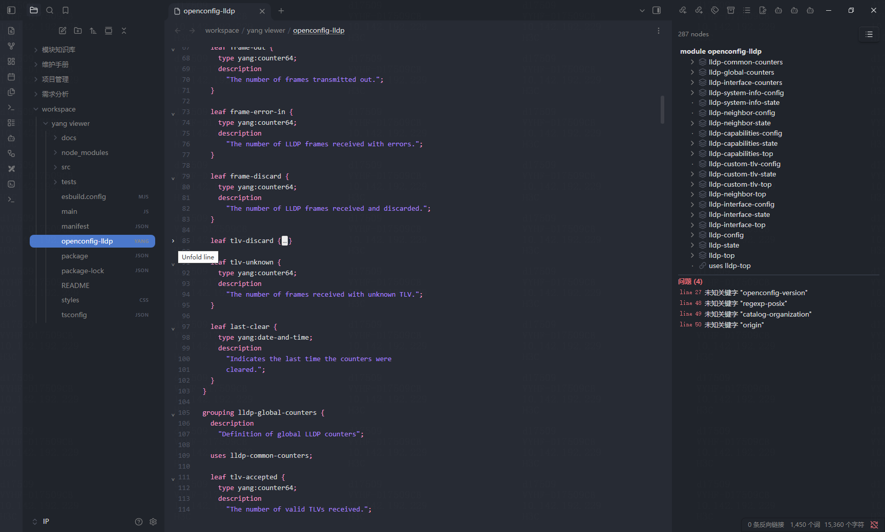

# YANG Viewer

Obsidian plugin for editing and browsing YANG files (RFC 7950, network device models), supporting YANG 1.0 / 1.1.

Built for writing, modifying, and reading network device models alongside Markdown notes in Obsidian: single-file editing + syntax highlighting + outline navigation + real-time validation. Does not resolve external modules referenced by `import`/`include`.



## Features

### Editor
- `.yang` files are visible in the Obsidian file list; click to open in the built-in editor
- YANG syntax highlighting: keywords / strings (including multi-line) / comments / punctuation
- Real-time validation: wavy underlines on error lines, hover for error details
- Code folding: brace-block folding with gutter click
- Editor font / font size settings (system font enumeration, hot-applied)

### Outline navigation
- Sidebar tree outline: collapsible node tree, icons per keyword
- Click a node to jump to its line in the editor, field-level positioning with brief highlight
- `uses` jumps to the referenced grouping definition; `augment` jumps to the node named by the target path's last segment
- Table mode: node / type / path / line / key properties columns
- Toggle tree/table via command `Switch to table view`
- Bottom error panel (sorted by line number), click to jump

### Validation
- Syntax layer: hand-built scanner (line numbers, per-error recovery) + `yang-parser` as authoritative fallback check
- Semantic rules:
  1. `list` `key` reference check (must be a direct child `leaf`)
  2. `type` reference check (built-in types or local typedefs)
  3. Duplicate `typedef` name check
  4. `yang-version` value check (`1` / `1.1`)
  5. `mandatory true` + `default` conflict warning

## Installation

1. Copy `main.js`, `manifest.json`, `styles.css` into your vault's `.obsidian/plugins/yang-viewer/`
2. Enable YANG Viewer in Obsidian settings → Community plugins
3. Open any `.yang` file

## Usage

Open the outline via any of:
- Command palette: `Show YANG outline`
- File list right-click on a `.yang` file → Show YANG outline
- Editor context menu → Show YANG outline

Adjust the editor font / font size in the settings tab.

## Development

```bash
npm install
npm run dev     # watch mode build
npm test        # run unit tests (vitest)
npm run build   # production build (tsc + esbuild minify)
```

- Tests: `tests/parserAdapter.test.ts` (adapter + fixtures), `tests/rules.test.ts` (semantic rules)
- Fixtures: `tests/fixtures/*.yang` (valid module, 1.1 features, semantic errors, syntax errors, choice/case nesting)
- Hot reload: copy build output to a test vault's `.obsidian/plugins/yang-viewer/`, or use the hot-reload plugin

## Architecture

```
main.ts                     Plugin entry: view/command/menu/settings registration
├─ views/processor.ts       Debounced parse scheduling + cache + change notification
├─ views/outline.ts         Tree/table outline view (uses/augment jump-to-definition)
├─ views/yangTextView.ts    TextFileView editor host (CM6 mounting, jump-to-line)
├─ views/editor.ts          CM6 extensions: theme/diagnostics/folding/flash
├─ views/yangParser.ts      StreamParser syntax highlighting
└─ lib/
   ├─ parserAdapter.ts      Hand-built scanner with line numbers + yang-parser authoritative check
   ├─ model.ts              Unified node model (YangNode/YangDocument)
   └─ rules.ts              Five semantic rules (independent functions)
```
